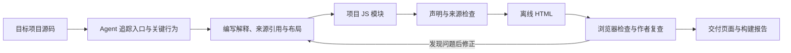

<div align="center">
  
  <h1>LitFlux</h1>
  <p><strong>从业务流程读懂代码，沿着图找到源码。</strong></p>
  <p>面向代码理解的 Agent Skill · 交互式项目脉络图 · 离线阅读</p>
  <p>
    <a href="LICENSE"></a>
  </p>
  <p>
    <a href="#why-litflux">为什么用 LitFlux</a> ◆
    <a href="#quick-start">快速开始</a> ◆
    <a href="#demo">教学演示</a> ◆
    <a href="#installation">安装</a> ◆
    <a href="#how-it-works">工作原理</a>
  </p>
</div>

LitFlux 让编码 Agent 阅读真实源码，把项目的用途、业务组成和内部流程整理成可以逐层探索的页面。你可以从一个入口出发，查看输入如何变成结果、条件分支如何影响流程，再打开相关源码核对实现。

生成的项目脉络图是一个可离线打开的 HTML 文件，包含图、说明和引用的源码摘录。适合接手陌生项目、理解关键算法，或在修改代码前梳理受影响的业务流程。

<a id="why-litflux"></a>

## 为什么用 LitFlux

- **先建立全貌，再进入细节。** 业务分解图展示组成关系；进入子业务后，内部流程图解释这一层的输入、处理、判断与结果。
- **读图时保留上下文。** 当前层的对象与关系完整展示，选择对象会高亮并更新说明；业务目录、分支情景和逐步阅读帮助你沿流程探索。
- **关键解释有出处。** 图中的来源引用关联到文件与行范围，页面内可查看源码摘录。
- **按问题决定深度。** 可以快速了解全局，也可以要求某个算法或流程讲得更细。默认展开到影响结果的关键机制。
- **便于保存与分享。** 页面离线可读，无需启动目标应用；工作材料和检查报告保留在本地。

<a id="quick-start"></a>

## 快速开始

准备一个能读取本地文件、运行 Python 和 Node.js 的编码 Agent，以及本仓库的本地副本。首次使用可以直接指定技能文件，不必先安装。

**1. 在 Agent 中打开你要理解的项目。**

**2. 将下面请求中的路径替换为本仓库 `skills/litflux/SKILL.md` 的绝对路径，然后发送：**

```text
请读取 <LitFlux 仓库绝对路径>/skills/litflux/SKILL.md，并按该技能理解当前项目。
为第一次接触项目的读者生成中文项目导览和项目脉络图，重点讲清主要入口、
关键处理、条件分支和结果。只读取目标源码，不修改源码、不运行目标业务程序。
结果保存到 .litflux/output/，交付 HTML 链接、建议阅读入口、检查结果和未完成项。
```

**3. 打开 Agent 交付的 HTML，从感兴趣的工作流开始阅读。**

已安装技能时，可以直接说：

```text
使用 $litflux 帮我理解当前项目。我要修改检索算法，请把检索流程讲细一些，
其他部分按默认深度展开，并指出还不能从源码确认的行为。
```

运行环境见[安装](#installation)。生成时间取决于项目规模、讲解范围和检查修正轮次。

<a id="demo"></a>

## 教学演示

仓库附带一段小型[文本保存源码](skills/litflux/examples/semantic-source/app.py)及对应的[项目模块](skills/litflux/examples/project-example.js)：文本规范化后判断是否为空，非空时通过写入器保存；批量入口逐条提交并累计结果。

在仓库根目录执行：

```sh
python skills/litflux/scripts/build_graph.py skills/litflux/examples/project-example.js .litflux/example --source-root skills/litflux/examples/semantic-source --no-browser
```

Windows 如没有 `python` 命令，将它替换为 `py -3`。

随后用浏览器打开 `.litflux/example/litflux_文本保存 · 项目脉络.html`，可以尝试：

1. 在“提交并保存文本”和“批量提交文本”之间切换。
2. 进入“保存文本”，查看写入器与文件的作用。
3. 切换非空与空文本情景，沿阅读步骤查看分支。
4. 打开带有来源引用的对象，核对教学源码。

这条命令跳过自动浏览器检查，生成结果保持 `draft`，用于先体验页面。安装好 `agent-browser` 后，去掉 `--no-browser` 可运行完整构建检查；实际状态以构建报告为准。

也可以下载仓库后，在浏览器打开 [UI Lab 界面演示](ui-lab/01-paper.html)。它使用虚构的 Lumen 馆藏项目展示阅读界面；源码教学例与界面演示的用途不同，后者不代表真实项目的分析结果。

<a id="installation"></a>

## 安装

### 运行环境

| 环境 | 用途 |
| --- | --- |
| 编码 Agent | 阅读源码、组织解释、编写项目模块与布局、检查并修正产物 |
| Python 3.11+ | 运行构建脚本；Python 部分只使用标准库 |
| Node.js 18+ | 求值 Agent 编写的项目 JS 模块 |
| 桌面浏览器 | 打开离线 HTML；页面主要面向 PC 阅读 |
| `agent-browser` | 自动检查页面声明、几何和部分交互；需预先安装，LitFlux 不会自动安装 |

缺少 `agent-browser` 时仍可生成页面，但不能获得 `checked` 状态。阅读已生成的 HTML 不需要 Python、Node.js 或 Agent。

### 直接使用本地技能

把本仓库 `skills/litflux/SKILL.md` 的绝对路径交给 Agent，即可使用[快速开始](#quick-start)中的请求。脚本、资源和参考文档需要与该文件保持原有目录关系。

### 安装为 Codex 个人技能

将 `skills/litflux/` 中以下内容复制到 `~/.agents/skills/litflux/`；Windows 对应 `%USERPROFILE%\.agents\skills\litflux\`：

```text
litflux/
├── SKILL.md
├── LICENSE
├── NOTICE
├── agents/
├── assets/
├── examples/
├── references/
└── scripts/
```

无需复制本地生成的 `.litflux/`、缓存或历史产物。安装目录已有同名技能时，先保留旧副本，再更新上述内容。技能发现与调用方式参见 [Codex 官方技能文档](https://developers.openai.com/codex/skills/)。

仓库根目录的 `plugin.json` 保存包元数据；本地技能可直接使用，插件市场分发状态需另行确认。

<a id="how-it-works"></a>

## 工作原理



Agent 负责解释源码、划分业务层级、判断关系并安排坐标。工具按声明绘制页面，检查来源范围、结构、几何和已实现的交互项。整个流程静态读取目标源码，不导入或执行目标应用。

### 两张图，回答两个问题

| 图 | 回答的问题 | 阅读方式 |
| --- | --- | --- |
| 业务分解图 | 这个业务由哪些子业务组成？ | 展开层级、选择业务、进入与返回 |
| 内部流程图 | 输入如何经过处理和条件形成结果？ | 查看当前层全部关系、切换情景、逐步阅读、查看源码 |

内部流程图区分业务、数据、资源与组件；判断和循环表达控制结构。数据边的实线表示即时承接，虚线表示保留后用，线型由 Agent 根据源码声明。完整规则见[图的含义](skills/litflux/references/mechanism.md)。

### 产物与工作目录

默认工作材料放在 `.litflux/work/`，交付放在 `.litflux/output/`；用户指定目录时以指定路径为准。

| 产物 | 内容 |
| --- | --- |
| `litflux_<项目标题>.html` | 离线阅读页面、交互图和引用源码 |
| `litflux.graph.json` | 求值后的项目模型、源码摘录与修订标识 |
| `litflux.build-report.json` | 检查结果、几何告警、复核结果与交付状态 |

图文支持中文和英文，按用户要求、否则按请求语言编写。源码、标识符与路径保留原样；技能说明和过程记录使用中文。

## 如何判断交付是否可用

构建报告会区分三种状态：

| 状态 | 表示什么 |
| --- | --- |
| `draft` | 已生成页面，但浏览器或几何检查尚未通过或尚未运行 |
| `checked` | 声明校验通过、浏览器报告通过且几何零告警 |
| `reviewed` | 达到 `checked`，且针对当前修订的独立复核材料通过检查 |

`checked` 的交互覆盖有限，不能替代逐工作流操作、关键情景检查和实际截图查看。来源存在也不等于解释正确；工具无法证明独立复核者身份或证据内容。交付时应同时查看 Agent 报告的语义自查、视觉与交互检查，以及剩余未知项。

当前尚未实现跨视图共享实例合并和精确形参／返回端口映射。必要行为无法忠实表达时，应明确记录缺口。源码更新后，需要重新核对解释与引用并构建页面。

## 开发与贡献

欢迎改进源码解释示例、图的可读性、交互体验和检查覆盖。提交问题时，请附复现步骤、构建报告，以及能说明问题的最小源码或截图。

| 想了解什么 | 从哪里开始 |
| --- | --- |
| Agent 的完整工作流程 | [技能入口](skills/litflux/SKILL.md) |
| 对象、关系、分解尺度与读图规则 | [机制说明](skills/litflux/references/mechanism.md) |
| 模块字段、绘图原语、命令与复核格式 | [作者方式](skills/litflux/references/semantic-authoring.md) |
| 一个可运行的项目模块 | [教学例](skills/litflux/examples/project-example.js) |
| 当前产品约束 | [项目规范](SPEC.md) |
| 历史版本变更 | [版本记录](CHANGELOG.md)；历史机制不代表当前实现 |

在仓库根目录预检教学模块：

```sh
python skills/litflux/scripts/build_graph.py skills/litflux/examples/project-example.js --source-root skills/litflux/examples/semantic-source --preflight
```

预检检查声明与来源，不执行 `draw()`，不能替代浏览器验收。更改模块、绘图或引擎后，应重新构建并检查实际页面；不要只凭命令退出成功判断交付状态。

## 许可证

LitFlux 的原创代码和文档采用 [Apache License 2.0](LICENSE)。技能包的许可说明见 [NOTICE](skills/litflux/NOTICE)。页面中引用的目标项目源码仍遵循其原有许可证。
