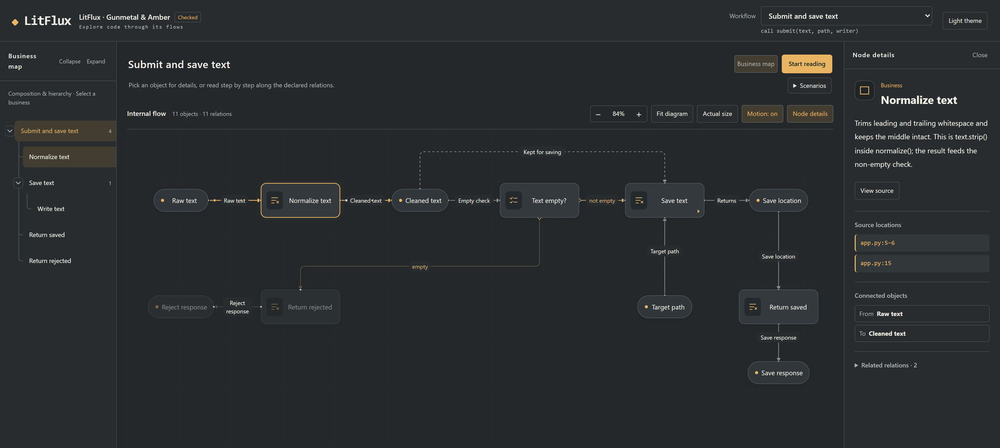
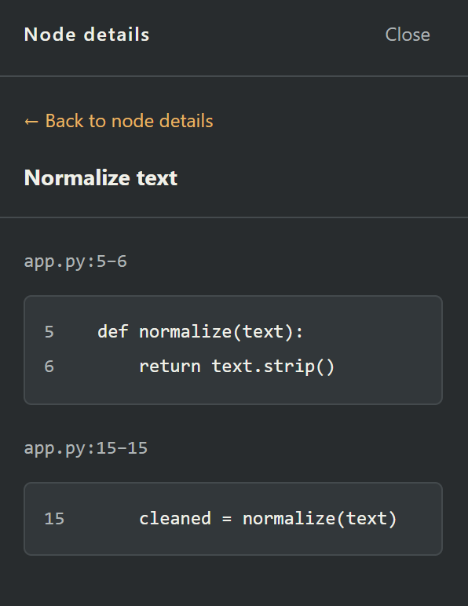
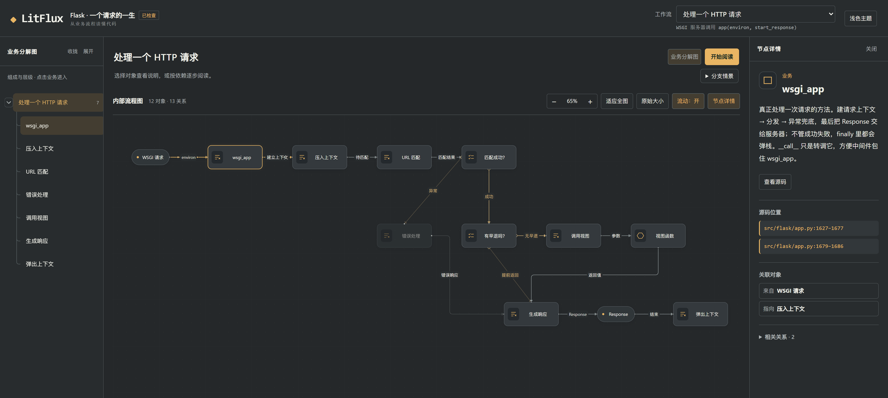
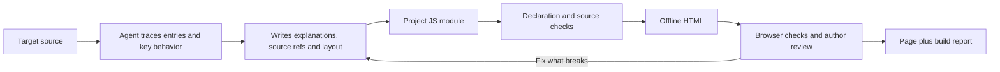

<div align="center">
  <h1>LitFlux</h1>
  <p><strong>AI-written code you can't read. A repo too big to finish. Read the flow first, then the source.</strong></p>
  <p>A coding agent reads the real source and draws the project as clickable business and flow maps, with every explanation pointing back to a file and line.</p>
  <p>
    <a href="LICENSE"></a>
    
    
    
  </p>
  <p>
    <a href="README.zh.md">简体中文</a> · <strong>English</strong>
  </p>
  <p>
    <a href="#problems">The problem</a> ◆
    <a href="#solution">How LitFlux fixes it</a> ◆
    <a href="#case">Case</a> ◆
    <a href="#quick-start">Quick start</a> ◆
    <a href="#installation">Installation</a> ◆
    <a href="#how-it-works">How it works</a>
  </p>
</div>

<a id="problems"></a>

## The same four things keep happening

- **You can't read AI-written code.** The agent hands back a working module in minutes. Reviewing it means reading line by line: why it is layered this way, where the boundaries sit, what breaks if you delete that block. The code itself will not say.
- **The repo is too big to finish.** You open a repository you have never seen. The README was last touched two years ago, there are dozens of directories, and three hops from the entry point you no longer know which layer you are standing in.
- **You understand functions, not the whole.** One function reads fine, but where it ranks in the business, who calls it, and what a change breaks means walking a call chain across a dozen files.
- **An AI summary you cannot check.** The architecture write-up sounds reasonable, and not one sentence maps to a file and a line.

<a id="solution"></a>

## How LitFlux fixes it

LitFlux is a skill for coding agents. The agent only reads source — it never runs the target program — and turns the project into one interactive page. You read down from a business entry and open the code when you need detail. No reading from line one to line ten thousand: spend a few minutes seeing which businesses exist, then follow the one chain your question is about.

What you get is not a summary you have to trust. It is three things:

1. **A business map**: which businesses make up the project, and which one contains which.
2. **An internal flow**: pick a business and see how input, processing, decisions and results connect in that layer, branches and loops included.
3. **A source location for every node**: file and line, one click away from the excerpt.

Reading it looks like this:

- Hover or focus a node for a one-line description; click for the full explanation, connected objects and source location.
- Selecting an object highlights the relations in the current layer, so context never jumps away.
- Decisions and loops are explicit relations: empty text taking the reject path, a batch submitting one item at a time, switchable by scenario.
- Depth is yours. By default it expands to the mechanisms that change the outcome; ask for `go deeper on the search flow` and that part gets more detail.

The result is a single file: one HTML page that opens on a double-click. No service to start, and no code uploaded anywhere.

<a id="case"></a>

## Case: what a real build looks like

Below is a real build. The source it explains is a small "text saving" program (normalize → emptiness check → write). LitFlux broke it into 3 workflows, 51 objects and 45 relations, with the build state `checked` — the "Checked" badge next to the page title.

<a href="docs/case/litflux-case-en.html"></a>

Left column is the business map, middle is the internal flow of the current layer, right is the selected node's explanation and where it lives in `app.py`.

**[Open the full case →](docs/case/litflux-case-en.html)**

The file is self-contained and works offline. On GitHub you land on the raw file first: use Download in the top-right corner, then double-click it. "Gunmetal & Amber" in the page title is the theme this build was drawn with. Build notes are in [docs/case](docs/case/README.en.md).

Things to try in the page:

1. Switch between "Submit and save text", "Batch submit texts" and "Resource types and source mapping" in the workflow picker.
2. Open the "Save text" sub-business, read it, then step back up.
3. Open "Scenarios" and switch between "not empty: save" and "empty: reject" — watch which branch lights up.
4. Select "Normalize text" and the page shows the excerpt at `app.py:5-6`.

<div align="center">
  
  <br>
  <sub>Step 4 in practice: explanation, file and line, and the code itself. Whether it is right, check that line yourself.</sub>
</div>

### Second case: a real repository

The teaching sample is small on purpose. A second build runs on a real one: Flask's request lifecycle, from `app(environ, start_response)` to `ctx.pop(error)` — 12 objects and 13 relations, also `checked`.

<a href="docs/case/flask-request.html"></a>

It follows `wsgi_app`, `full_dispatch_request`, `preprocess_request`, `dispatch_request`, `finalize_request` and `process_response` in `src/flask/app.py`, plus `push` and `match_request` in `ctx.py`. Excerpts come from [pallets/flask](https://github.com/pallets/flask) (BSD-3-Clause); the authored module is [published next to the page](docs/case/flask-request.module.js).

**[Open the Flask case →](docs/case/flask-request.html)**

<details>
<summary>Build one yourself</summary>

The repository ships a small [text-saving source](skills/litflux/examples/semantic-source/app.py) and its [project module](skills/litflux/examples/project-example.js): text is normalized, checked for emptiness, and saved through a writer; the batch entry submits items one at a time and accumulates results.

From the repository root:

```sh
python skills/litflux/scripts/build_graph.py skills/litflux/examples/project-example.js .litflux/example --source-root skills/litflux/examples/semantic-source --no-browser
```

On Windows without a `python` command, use `py -3`.

Then open `.litflux/example/litflux_文本保存 · 项目脉络.html` in a browser. This command skips the browser check, so the result stays `draft` — enough to look around. Drop `--no-browser` once `agent-browser` is installed to run the full check; the build report is the source of truth for the actual state.

</details>

<a id="quick-start"></a>

## Quick start

You need a coding agent that can read local files and run Python and Node.js, plus a local copy of this repository. For a first try you can point the agent at the skill file directly; no installation needed.

**1. Open the project you want to understand in the agent.**

**2. Replace the path below with the absolute path to this repository's `skills/litflux/SKILL.md`, then send it:**

```text
Read <absolute path to LitFlux>/skills/litflux/SKILL.md and use that skill to understand this project.
Write an English tour and project map for a reader who has just opened the repository: cover the main
entry points, key processing, branches and results. Read the target source only, do not modify it,
and do not run the target application. Save the result under .litflux/output/ and report the HTML
link, where to start reading, the check results and anything still unfinished.
```

**3. Open the delivered HTML and start from the workflow you care about.**

With the skill installed, you can just say:

```text
Use $litflux to explain this project. I'm changing the search algorithm — go deeper on the search
flow, keep the rest at the default depth, and call out anything you cannot confirm from the source.
```

Environment details are in [Installation](#installation).

<a id="installation"></a>

## Installation

### Requirements

| What | Used for |
| --- | --- |
| Coding agent | Reading source, organizing explanations, writing the project module and layout, checking and fixing output |
| Python 3.11+ | Running the build scripts; the Python side uses only the standard library |
| Node.js 18+ | Evaluating the project JS module the agent writes |
| Desktop browser | Opening the offline HTML; the page is designed for desktop reading |
| `agent-browser` | Automated checks of declarations, geometry and some interactions; must be installed in advance, LitFlux never installs it |

Without `agent-browser` you still get a page, but not the `checked` state. Reading an already built HTML needs none of Python, Node.js or an agent.

### Use the local skill directly

Hand the agent the absolute path to `skills/litflux/SKILL.md` and use the prompt from [Quick start](#quick-start). Scripts, assets and reference documents must keep their directory relationship with that file.

### Install as a Codex personal skill

Copy the following from `skills/litflux/` into `~/.agents/skills/litflux/` (on Windows: `%USERPROFILE%\.agents\skills\litflux\`):

```text
litflux/
├── SKILL.md
├── LICENSE
├── NOTICE
├── agents/
├── assets/
├── examples/
├── references/
└── scripts/
```

No need to copy locally generated `.litflux/` directories, caches or old output. If a skill with the same name already exists, keep the old copy before updating. See the [Codex skills documentation](https://developers.openai.com/codex/skills/) for discovery and invocation.

`plugin.json` at the repository root carries the package metadata; the local skill works as-is, and marketplace distribution is a separate question.

<a id="how-it-works"></a>

## How it works



The agent explains the source, splits the business layers, decides relations and places coordinates. The tool draws what was declared and checks source ranges, structure, geometry and the interactions it implements. The whole pipeline reads the target source statically; it never imports or runs the target application.

### Two maps, two questions

| Map | Question it answers | How you read it |
| --- | --- | --- |
| Business map | Which sub-businesses make up this business? | Expand levels, pick a business, enter and go back |
| Internal flow | How do inputs become a result through processing and conditions? | All relations in the layer, scenarios, step-by-step reading, source |

The internal flow separates business, data, resources and components; decisions and loops express control structure. Solid data edges mean immediate handover, dashed ones mean kept for later — the agent declares the timing from the source, the tool does not derive it. Full rules are in [what the map means](skills/litflux/references/mechanism.md).

### Artifacts and working directory

Working material goes to `.litflux/work/`, deliverables to `.litflux/output/`; a user-specified path wins.

| Artifact | Contents |
| --- | --- |
| `litflux_<title>.html` | Offline reading page, interactive maps and quoted source |
| `litflux.graph.json` | Evaluated project model, source excerpts and revision id |
| `litflux.build-report.json` | Check results, geometry warnings, review result and delivery state |

Pages can be written in Chinese or English, following the user's request or else the language of the request. Source, identifiers and paths keep their original form.

## Is a build good enough to use?

The build report separates three states:

| State | What it means |
| --- | --- |
| `draft` | A page exists, but browser or geometry checks have not passed or have not run |
| `checked` | Declaration checks passed, the browser report passed, and geometry has no blocking defect |
| `reviewed` | Reaches `checked`, and an independent review of this revision has passed its checks |

`--geometry-only` shortens geometry iteration (still needs the browser, state stays `draft`); run the full build before delivering.

`checked` covers a limited set of interactions and does not replace walking each workflow, checking key scenarios or looking at real screenshots. A source location existing does not make an explanation correct; the tool cannot prove who the independent reviewer is or what the evidence contains. When delivering, read the agent's semantic self-check, the visual and interaction notes, and the remaining unknowns together.

Cross-view merging of shared instances and exact parameter/return port mapping are not implemented yet. When a needed behavior cannot be expressed faithfully, record the gap. After the source changes, re-check explanations and references before rebuilding.

## Contributing

Improvements to the explanation examples, map readability, interaction and check coverage are welcome. For issues, include reproduction steps, the build report, and the smallest source sample or screenshot that shows the problem.

| Looking for | Start here |
| --- | --- |
| The agent's full workflow | [Skill entry](skills/litflux/SKILL.md) |
| Objects, relations, decomposition scale and reading rules | [Mechanism](skills/litflux/references/mechanism.md) |
| Module fields, drawing primitives, commands and review format | [Authoring guide](skills/litflux/references/semantic-authoring.md) |
| A runnable project module | [Teaching example](skills/litflux/examples/project-example.js) |
| Current product constraints | [Spec](SPEC.md) |
| Node descriptions and resource symbols | [Authoring guide](skills/litflux/references/semantic-authoring.md#节点介绍参考), [resource examples](skills/litflux/examples/resource-examples.js) |
| Layout thinking and size measurement | [Layout guidance](skills/litflux/references/layout-guidance.md), for authors to take or leave |
| The full case and its build notes | [Case notes](docs/case/README.en.md) |
| UI directions | [UI Lab](ui-lab/README.md), interface demos with fictional data — not findings about a real project |

Preflight the teaching module from the repository root:

```sh
python skills/litflux/scripts/build_graph.py skills/litflux/examples/project-example.js --source-root skills/litflux/examples/semantic-source --preflight
```

Preflight checks declarations and sources, does not run `draw()`, and cannot replace browser acceptance. After changing the module, the drawing code or the engine, rebuild and look at the actual page; do not treat a zero exit code as delivery quality.

## License

LitFlux's original code and documentation are under the [Apache License 2.0](LICENSE). License notes for the skill package are in [NOTICE](skills/litflux/NOTICE). Source code of target projects quoted in a page keeps its own license.
