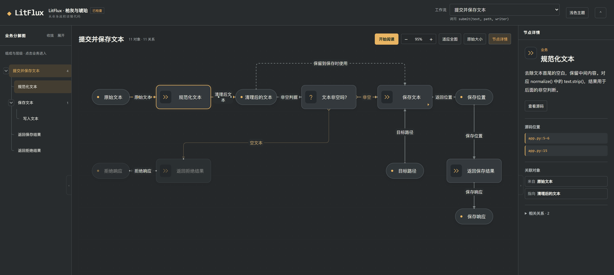
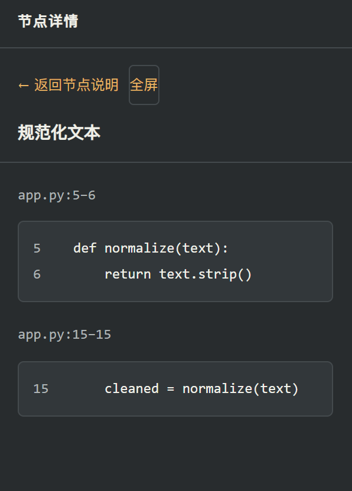
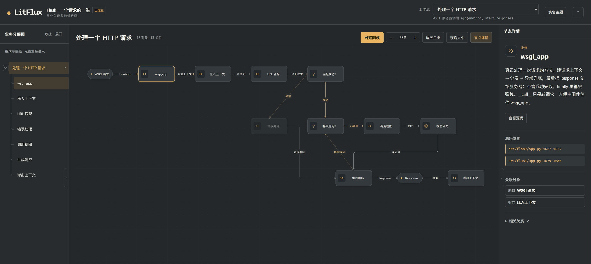
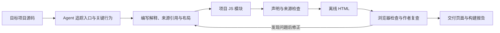

<div align="center">
  <h1>LitFlux</h1>
  <p><strong>AI 写的代码看不懂，项目太大看不完？先看业务，再翻源码。</strong></p>
  <p>编码 Agent 读真实源码，把项目画成能逐层点开的业务图与流程图，每个解释都标着它在代码里的位置。</p>
  <p>
    <a href="LICENSE"></a>
    
    
    
  </p>
  <p>
    <strong>简体中文</strong> · <a href="README.md">English</a>
  </p>
  <p>
    <a href="https://elsya111.github.io/litflux/">在线案例</a> ◆
    <a href="#problems">痛点</a> ◆
    <a href="#solution">LitFlux 怎么解决</a> ◆
    <a href="#case">案例</a> ◆
    <a href="#quick-start">快速开始</a> ◆
    <a href="#installation">安装</a> ◆
    <a href="#how-it-works">工作原理</a>
  </p>
</div>

<a id="problems"></a>

## 这几件事，大概每次都会撞上

- **AI 写的代码看不懂。** Agent 几分钟就交回一个能跑的项目，可你 review 时只能一行行往下读：它为什么这样分层、边界画在哪、删掉这段会牵连什么，代码本身不会说。
- **项目太大看不完。** 接手一个陌生仓库，README 停在两年前，目录几十个，从入口往里跳三次就不知道自己站在哪一层。硬读完，一下午就没了。
- **看得懂函数，看不懂全局。** 单个函数读得明白，但它在业务里排第几、被谁调用、改它会影响哪条链路，得顺着调用链翻十几个文件。
- **让 AI 讲一遍，你没法核对。** 它给出的架构总结读起来都很合理，可惜没有一句能对上具体文件和行号。

<a id="solution"></a>

## LitFlux 怎么解决

LitFlux 是一个给编码 Agent 用的技能（Skill）。Agent 只读源码、不运行目标程序，把项目整理成一页可交互的图；你从业务入口往下读，需要细节时再翻到对应代码。不用从第一行读到第一万行：先花几分钟看清这个项目有哪些业务，再挑和你的问题相关的那条链路往下钻。

它给的不是一段无法核对的总结，而是三样东西：

1. **业务分解图**：这个项目由哪些业务组成，谁属于谁。
2. **内部流程图**：选中一个业务，看清这一层的输入、处理、判断和结果，条件分叉与循环都在图上。
3. **每个节点的出处**：文件与行号，点开就是源码摘录。

读起来是这样的：

- 悬浮或聚焦节点先看一句短介绍，点击看完整说明、关联对象和源码位置。
- 选中一个对象，当前层的关系一起高亮，上下文不会被切走。
- 判断和循环用显式关系表达：空文本走拒绝、批量逐条提交，都能按情景看。
- 深度由你决定。默认展开到影响结果的关键机制，想深入就补一句「把检索流程讲细一点」。

最后落成一个文件：单个 HTML，双击就能打开，不用启动目标服务，也不用把代码传到任何地方。

<a id="case"></a>

## 案例：一份真实产物长什么样

下面是一份真实构建产物。被解释的源码是一个小型「文本保存」程序（归一化 → 判空 → 写入），LitFlux 把它拆成 3 个工作流、51 个对象、45 条关系。

<a href="https://elsya111.github.io/litflux/case/litflux-case.html"></a>

左栏是业务分解，中间是当前层的内部流程，右栏是被选中节点的说明和它在 `app.py` 里的位置。

**[在浏览器里打开案例 →](https://elsya111.github.io/litflux/case/litflux-case.html)**

同一份页面也提交在仓库的 `docs/case/litflux-case.html`，可离线打开。页面标题里的「枪灰与琥珀」是这份构建采用的主题名。案例的构建记录和说明见 [docs/case](docs/case/README.md)。

页面里可以试这几步：

1. 用右上角的工作流下拉，在「提交并保存文本」「批量提交文本」「资源类别与源码对应」之间切换。
2. 进入「保存文本」子业务，看完再返回上一级。
3. 点击图上的「文本非空吗？」判断节点，在「非空：保存」和「空：拒绝」之间切换，看哪条分支亮起来。
4. 点击「规范化文本」，页面给出 `app.py:5-6` 的源码摘录。

<div align="center">
  
  <br>
  <sub>第 4 步的样子：说明、文件行号、原文一起给。讲得对不对，翻到那一行自己看。</sub>
</div>

### 第二个案例：一个真实仓库

教学例是有意做小的。第二个构建跑在真实仓库上：Flask 的请求生命周期，从 `app(environ, start_response)` 到 `ctx.pop(error)`——12 个对象、13 条关系，同样是 `checked`。

<a href="https://elsya111.github.io/litflux/case/flask-request.html"></a>

它追的是 `src/flask/app.py` 里的 `wsgi_app`、`full_dispatch_request`、`preprocess_request`、`dispatch_request`、`finalize_request`、`process_response`，加上 `ctx.py` 的 `push` 与 `match_request`。摘录来自 [pallets/flask](https://github.com/pallets/flask)（BSD-3-Clause），作者模块也[随页面一起提供](docs/case/flask-request.module.js)。

**[打开 Flask 案例 →](https://elsya111.github.io/litflux/case/flask-request.html)**

<details>
<summary>想自己跑一遍构建</summary>

仓库附带一段小型[文本保存源码](skills/litflux/examples/semantic-source/app.py)及对应的[项目模块](skills/litflux/examples/project-example.js)：文本规范化后判断是否为空，非空时通过写入器保存；批量入口逐条提交并累计结果。

在仓库根目录执行：

```sh
python skills/litflux/scripts/build_graph.py skills/litflux/examples/project-example.js .litflux/example --source-root skills/litflux/examples/semantic-source --no-browser
```

Windows 如没有 `python` 命令，将它替换为 `py -3`。

随后用浏览器打开 `.litflux/example/litflux_文本保存 · 项目脉络.html`。这条命令跳过自动浏览器检查，结果保持 `draft`，用来先体验页面；装好 `agent-browser` 后去掉 `--no-browser` 可运行完整构建检查，实际状态以构建报告为准。生成时间取决于项目规模、讲解范围和检查修正轮次。

</details>

<a id="quick-start"></a>

## 快速开始

准备一个能读取本地文件、运行 Python 和 Node.js 的编码 Agent，以及本仓库的本地副本。首次使用可以直接指定技能文件，不必先安装。

**1. 在 Agent 中打开你要理解的项目。**

**2. 把下面请求里的路径换成本仓库 `skills/litflux/SKILL.md` 的绝对路径，然后发送：**

```text
请读取 <LitFlux 仓库绝对路径>/skills/litflux/SKILL.md，并按该技能理解当前项目。
为第一次接触项目的读者生成中文项目导览和项目脉络图，重点讲清主要入口、
关键处理、条件分支和结果。只读取目标源码，不修改源码、不运行目标业务程序。
结果保存到 .litflux/output/，交付 HTML 链接、建议阅读入口、检查结果和未完成项。
```

**3. 打开 Agent 交付的 HTML，从感兴趣的工作流开始读。**

已安装技能时，可以直接说：

```text
使用 $litflux 帮我理解当前项目。我要修改检索算法，请把检索流程讲细一些，
其他部分按默认深度展开，并指出还不能从源码确认的行为。
```

运行环境见[安装](#installation)。

<a id="installation"></a>

## 安装

### 运行环境

| 环境 | 用途 |
| --- | --- |
| 编码 Agent | 阅读源码、组织解释、编写项目模块与布局、检查并修正产物 |
| Python 3.11+ | 运行构建脚本；Python 部分只使用标准库 |
| Node.js 18+ | 求值 Agent 编写的项目 JS 模块 |
| 桌面浏览器 | 打开离线 HTML；页面主要面向 PC 阅读 |
| `agent-browser` | 自动检查页面声明、几何和部分交互；需预先安装，LitFlux 不会自动安装 |

缺少 `agent-browser` 时仍可生成页面，但拿不到 `checked` 状态。阅读已生成的 HTML 不需要 Python、Node.js 或 Agent。

### 直接使用本地技能

把本仓库 `skills/litflux/SKILL.md` 的绝对路径交给 Agent，即可使用[快速开始](#quick-start)里的请求。脚本、资源和参考文档需要与该文件保持原有目录关系。

### 安装为 Codex 个人技能

将 `skills/litflux/` 中以下内容复制到 `~/.agents/skills/litflux/`；Windows 对应 `%USERPROFILE%\.agents\skills\litflux\`：

```text
litflux/
├── SKILL.md
├── LICENSE
├── NOTICE
├── agents/
├── assets/
├── examples/
├── references/
└── scripts/
```

无需复制本地生成的 `.litflux/`、缓存或历史产物。安装目录已有同名技能时，先保留旧副本，再更新上述内容。技能发现与调用方式参见 [Codex 官方技能文档](https://developers.openai.com/codex/skills/)。

仓库根目录的 `plugin.json` 保存包元数据；本地技能可直接使用，插件市场分发状态需另行确认。

<a id="how-it-works"></a>

## 工作原理



Agent 负责解释源码、划分业务层级、判断关系并安排坐标。工具按声明绘制页面，检查来源范围、结构、几何和已实现的交互项。整个流程静态读取目标源码，不导入或执行目标应用。

### 两张图，回答两个问题

| 图 | 回答的问题 | 阅读方式 |
| --- | --- | --- |
| 业务分解图 | 这个业务由哪些子业务组成？ | 展开层级、选择业务、进入与返回 |
| 内部流程图 | 输入如何经过处理和条件形成结果？ | 查看当前层全部关系、切换情景、逐步阅读、查看源码 |

内部流程图区分业务、数据、资源与组件；判断和循环表达控制结构。数据边的实线表示即时承接，虚线表示保留后用，线型由 Agent 根据源码声明。完整规则见[图的含义](skills/litflux/references/mechanism.md)。

### 产物与工作目录

默认工作材料放在 `.litflux/work/`，交付放在 `.litflux/output/`；用户指定目录时以指定路径为准。

| 产物 | 内容 |
| --- | --- |
| `litflux_<项目标题>.html` | 离线阅读页面、交互图和引用源码 |
| `litflux.graph.json` | 求值后的项目模型、源码摘录与修订标识 |
| `litflux.build-report.json` | 检查结果、几何告警、复核结果与交付状态 |

图文支持中文和英文，按用户要求、否则按请求语言编写。源码、标识符与路径保留原样；技能说明和过程记录使用中文。

## 怎么判断交付能不能用

构建报告会区分三种状态：

| 状态 | 表示什么 |
| --- | --- |
| `draft` | 已生成页面，但浏览器或几何检查尚未通过或尚未运行 |
| `checked` | 声明校验通过、浏览器报告通过且几何无阻断缺陷 |
| `reviewed` | 达到 `checked`，且针对当前修订的独立复核材料通过检查 |

可用 `--geometry-only` 缩短几何迭代（仍需浏览器，状态为 draft）；完整构建后再交付。

`checked` 的交互覆盖有限，不能替代逐工作流操作、关键情景检查和实际截图查看。来源存在也不等于解释正确；工具无法证明独立复核者身份或证据内容。交付时应同时查看 Agent 报告的语义自查、视觉与交互检查，以及剩余未知项。

当前尚未实现跨视图共享实例合并和精确形参／返回端口映射。必要行为无法忠实表达时，应明确记录缺口。源码更新后，需要重新核对解释与引用并构建页面。

## 开发与贡献

欢迎改进源码解释示例、图的可读性、交互体验和检查覆盖。提交问题时，请附复现步骤、构建报告，以及能说明问题的最小源码或截图。

| 想了解什么 | 从哪里开始 |
| --- | --- |
| Agent 的完整工作流程 | [技能入口](skills/litflux/SKILL.md) |
| 对象、关系、分解尺度与读图规则 | [机制说明](skills/litflux/references/mechanism.md) |
| 模块字段、绘图原语、命令与复核格式 | [作者方式](skills/litflux/references/semantic-authoring.md) |
| 一个可运行的项目模块 | [教学例](skills/litflux/examples/project-example.js) |
| 当前产品约束 | [项目规范](SPEC.md) |
| 节点说明与资源符号 | [作者方式](skills/litflux/references/semantic-authoring.md#节点介绍参考)、[资源示例](skills/litflux/examples/resource-examples.js) |
| 排版思路与尺寸测量 | [布局参考](skills/litflux/references/layout-guidance.md)，供作者自行取舍 |
| 完整案例与构建记录 | [案例说明](docs/case/README.md) |
| 界面方向对比 | [UI Lab](ui-lab/README.md)，含虚构数据的界面演示，不代表真实项目结论 |

在仓库根目录预检教学模块：

```sh
python skills/litflux/scripts/build_graph.py skills/litflux/examples/project-example.js --source-root skills/litflux/examples/semantic-source --preflight
```

预检检查声明与来源，不执行 `draw()`，不能替代浏览器验收。更改模块、绘图或引擎后，应重新构建并检查实际页面；不要只凭命令退出成功判断交付状态。

## 许可证

LitFlux 的原创代码和文档采用 [Apache License 2.0](LICENSE)。技能包的许可说明见 [NOTICE](skills/litflux/NOTICE)。页面中引用的目标项目源码仍遵循其原有许可证。
